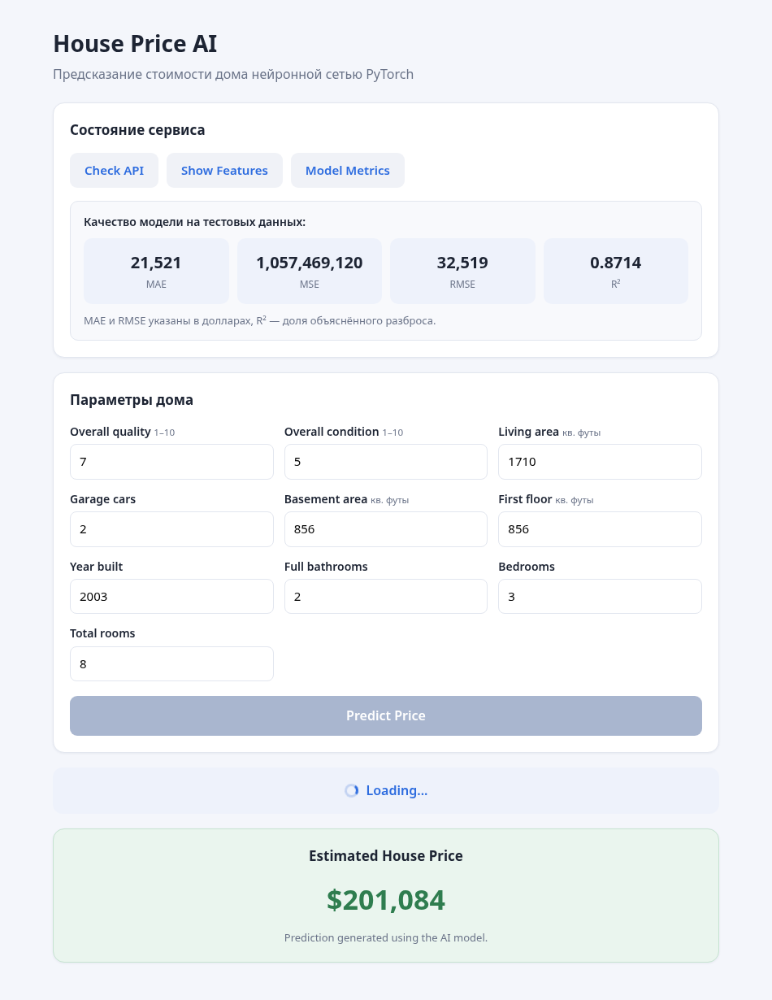

# Урок 11. Подключение модели машинного обучения к веб-интерфейсу

Предсказание стоимости дома нейронной сетью PyTorch с полноценным веб-интерфейсом.



## Что взято за основу

Задание требует дорабатывать проект с урока. Сам проект лежит в репозитории
преподавателя — на это указывает комментарий к заданию в MyStat: «Пример берёте
из гита».

Источник: `github.com/madiardzetibergen-hash/PA521`, папка `house-price-ai`.

**Без изменений взяты:** `main.py`, `model.py`, `train.py`, `requirements.txt` и
папка `artifacts` с обученной моделью, скейлерами и метриками. Бэкенд уже содержал
все нужные эндпоинты и пример `POST /predict`.

**Написано в этой работе:** вся папка `static` — `index.html`, `styles.css` и
`script.js`. В исходной версии фронтенд умел только предсказывать цену, а ошибки
показывал через `alert` и `console.log`.

## Что сделано по заданиям

| Задание | Что добавлено |
|---|---|
| 1. Проверка состояния сервера | Кнопка **Check API** → `GET /health`, выводит status, model loaded и число признаков |
| 2. Список признаков | Кнопка **Show Features** → `GET /features`, выводит все 10 признаков списком в две колонки |
| 3. Метрики модели | Кнопка **Model Metrics** → `GET /metrics`, выводит MAE, MSE, RMSE и R² карточками |
| 4. Индикатор загрузки | Блок `Loading...` с анимированным спиннером на время любого запроса, кнопки блокируются |
| 5. Обработка ошибок | Отдельный блок с сообщением, никаких `alert` и вывода только в консоль |

## Как устроена обработка ошибок

Все запросы идут через одну функцию `request()`. Она различает два случая:

* сервер недоступен — `fetch` бросает `TypeError`, пользователь видит
  **Unable to connect to the server.**;
* сервер ответил ошибкой — читается поле `detail` из тела ответа и показывается
  реальная причина, например какое поле не прошло валидацию.

Индикатор загрузки скрывается в блоке `finally`, поэтому он исчезает и при успехе,
и при любой ошибке.

Дополнительно поля формы проверяются до отправки: пустое или нечисловое значение
подсвечивается красным, и запрос не уходит.

## Запуск

```
pip install -r requirements.txt
uvicorn main:app --reload
```

Открыть `http://127.0.0.1:8000`.

## Эндпоинты

| Метод | Путь | Что возвращает |
|---|---|---|
| GET | `/` | Страницу интерфейса |
| GET | `/health` | `status`, `model_loaded`, `features_count` |
| GET | `/features` | Список признаков модели |
| GET | `/metrics` | MAE, MSE, RMSE, R² |
| POST | `/predict` | Предсказанную цену в долларах |

## Качество модели

| Метрика | Значение |
|---|---|
| MAE | $21 521 |
| RMSE | $32 519 |
| R² | 0.8714 |

Метрики взяты из `artifacts/metrics.json` — это результат обучения, выполненного
преподавателем, модель в работе не переобучалась.
