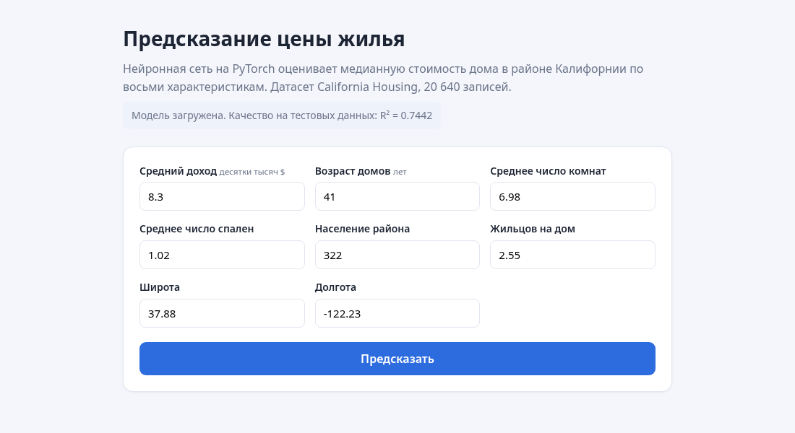

# Предсказание цены жилья в Калифорнии

Полный ML-проект: от датасета до работающего интерфейса. Нейронная сеть на
PyTorch предсказывает медианную стоимость дома в районе по восьми характеристикам.



## Какую задачу решает проект

Задача регрессии: по характеристикам района — доходу жителей, возрасту домов,
числу комнат, населению и координатам — предсказать медианную стоимость жилья.
Пользователь вводит параметры в форму и сразу получает оценку в долларах.

## Откуда взят датасет

**California Housing** — классический датасет по переписи населения Калифорнии
1990 года, опубликован на Kaggle как «California Housing Prices».

В проекте он загружается через `sklearn.datasets.fetch_california_housing`:
это те же самые данные, но скачивание не требует ключа Kaggle API. Скрипт
`dataset/prepare.py` сохраняет их в `dataset/data.csv`.

## Какие данные используются

20 640 записей, 8 признаков, пропусков нет.

| Признак | Что означает |
|---|---|
| `MedInc` | Медианный доход в районе, десятки тысяч долларов |
| `HouseAge` | Средний возраст домов |
| `AveRooms` | Среднее число комнат |
| `AveBedrms` | Среднее число спален |
| `Population` | Население района |
| `AveOccup` | Среднее число жильцов на дом |
| `Latitude`, `Longitude` | Координаты |

Целевая переменная `MedHouseVal` — медианная стоимость в сотнях тысяч долларов.

**Подготовка данных.** Удалены строки с ценой 5.0 — в исходных данных цена
обрезана сверху этим значением, и такие записи образуют искусственный «потолок»,
который модель пытается выучить как реальную закономерность. После фильтрации
осталось 19 648 строк. Признаки нормализованы через `StandardScaler`, обученный
только на train.

## Какая сеть и как обучалась

Полносвязная сеть на `nn.Module`: `8 → 64 → 32 → 16 → 1`, активация ReLU.
Функция потерь `MSELoss`, оптимизатор Adam с `lr=0.005`, 40 эпох, батч 256,
разделение 80/20 с `random_state=42`.

График падения ошибки — `model/loss.png`, числа по эпохам — `model/metrics.json`.

## Какой результат получился

| Метрика | Train | Test |
|---|---|---|
| MAE | 0.3212 | 0.3409 |
| R² | 0.7728 | 0.7442 |

Модель объясняет около 74% разброса цен на данных, которых не видела. Средняя
ошибка 0.34 в единицах таргета — это примерно **34 тысячи долларов**.

Разрыв между train и test небольшой, значит сильного переобучения нет. Главное
ограничение — в данных нет площади дома и его состояния, а координаты сеть
использует как грубый заменитель «престижности района».

## Структура

```
12-ml-project/
├── dataset/
│   ├── prepare.py        загрузка датасета
│   └── data.csv
├── model/
│   ├── train.py          архитектура и обучение
│   ├── predict.py        загрузка модели и предсказание
│   ├── model.pth         веса
│   ├── scaler.pkl        обученный StandardScaler
│   ├── metrics.json      метрики и история обучения
│   └── loss.png          график обучения
├── backend/
│   └── main.py           FastAPI
├── frontend/
│   ├── index.html
│   ├── style.css
│   └── script.js
├── screenshot.png
├── requirements.txt
└── README.md
```

## Как запустить

```
pip install -r requirements.txt
python dataset/prepare.py
python model/train.py
uvicorn backend.main:app --reload
```

Открыть `http://127.0.0.1:8000` — бэкенд сам отдаёт страницу фронтенда.

Предсказание из командной строки, без веба:

```
python model/predict.py 8.3 41 6.98 1.02 322 2.55 37.88 -122.23
```

## API

| Метод | Путь | Что делает |
|---|---|---|
| GET | `/` | Страница интерфейса |
| GET | `/health` | Статус модели и её R² на тесте |
| GET | `/features` | Список признаков и допустимые диапазоны |
| POST | `/predict` | Принимает 8 признаков, возвращает цену |

```
curl -X POST http://127.0.0.1:8000/predict -H "Content-Type: application/json" \
  -d '{"MedInc":8.3,"HouseAge":41,"AveRooms":6.98,"AveBedrms":1.02,
       "Population":322,"AveOccup":2.55,"Latitude":37.88,"Longitude":-122.23}'
```

## Защита от неправильного ввода

Проверка идёт в двух местах. На фронтенде поля сверяются с диапазонами, которые
приходят из `/features`: неверное поле подсвечивается, запрос не уходит. На
бэкенде та же проверка повторяется в `predict.py` — фронтенд можно обойти, поэтому
сервер не доверяет ему и возвращает 400 с понятным текстом.
