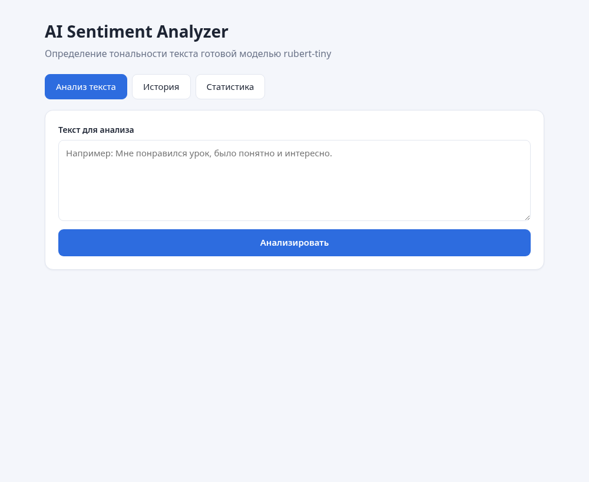
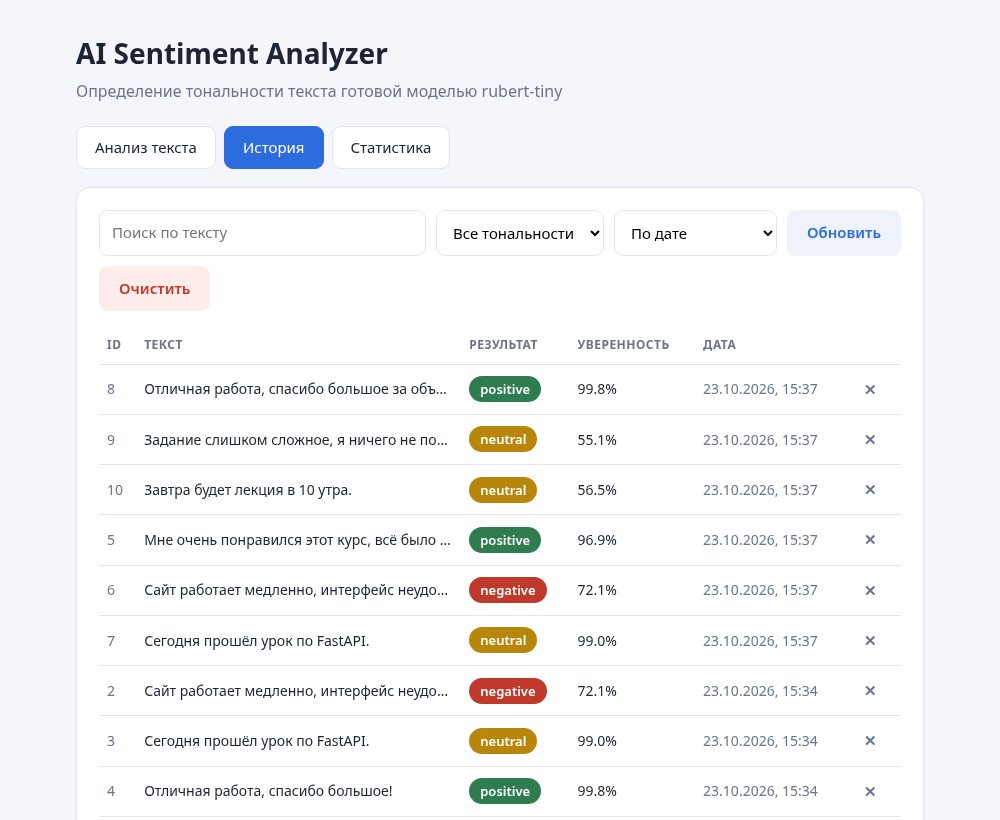
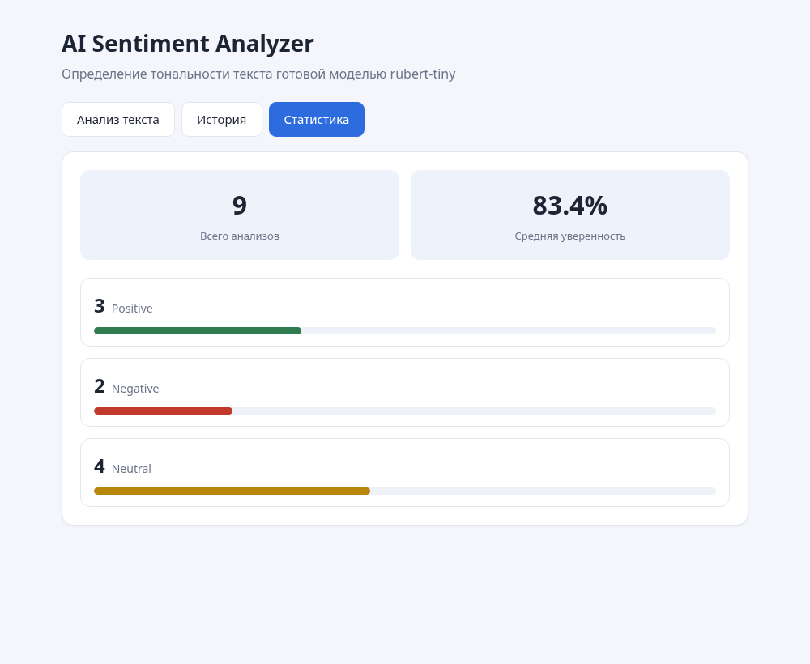

# AI Sentiment Analyzer

Fullstack-приложение для анализа тональности текста. Пользователь вводит отзыв
или комментарий, backend передаёт текст в готовую AI-модель, результат
сохраняется в SQLite и отображается на frontend.

## Описание проекта

Приложение определяет эмоциональную окраску текста и относит его к одному из трёх
классов: `positive`, `negative` или `neutral`. Каждый анализ попадает в историю,
по которой считается статистика.

Модель не понимает текст как человек. Она оценивает, к какому из классов текст
ближе по словам и их сочетаниям, и возвращает вероятность для каждого класса.

### Вкладка «Анализ текста»



### Вкладка «История»



### Вкладка «Статистика»



## Какая модель используется

**`cointegrated/rubert-tiny-sentiment-balanced`** — компактная русскоязычная
модель на базе RuBERT, обученная на задаче классификации тональности.

Почему именно она: примеры из задания на русском языке, а большинство готовых
моделей sentiment-анализа английские. Эта модель весит около 45 МБ и запускается
на процессоре без видеокарты, что важно при ограниченной памяти. Крупные
многоязычные модели дают результат чуть точнее, но весят сотни мегабайт.

Проверка на примерах из задания:

| Текст | Результат | Уверенность |
|---|---|---|
| Мне очень понравился этот курс, всё было понятно и интересно | positive | 96.9% |
| Сайт работает медленно, интерфейс неудобный, ничего не понятно | negative | 72.1% |
| Сегодня прошёл урок по FastAPI | neutral | 99.0% |

## Endpoints

| Метод | Путь | Что делает |
|---|---|---|
| GET | `/` | Проверка, что API работает, имя модели и список классов |
| POST | `/analyze` | Принимает текст, возвращает тональность и вероятности, сохраняет в базу |
| GET | `/analyses` | История анализов, поддерживает фильтр, поиск и сортировку |
| GET | `/analyses/{id}` | Один анализ по ID |
| DELETE | `/analyses/{id}` | Удаляет анализ из истории |
| DELETE | `/analyses` | Очищает всю историю |
| GET | `/stats` | Статистика: всего, средняя уверенность, количество по классам |

Параметры `/analyses`:

| Параметр | Значения | Назначение |
|---|---|---|
| `label` | `positive`, `negative`, `neutral` | Фильтр по тональности |
| `search` | любой текст | Поиск по содержимому |
| `sort` | `date`, `score`, `id` | Поле сортировки |
| `desc` | `true`, `false` | Направление сортировки |

## База данных

SQLite, файл `backend/analyses.db` создаётся автоматически при первом запуске.

| Поле | Тип | Смысл |
|---|---|---|
| `id` | INTEGER | Уникальный номер записи |
| `text` | TEXT | Текст, который ввёл пользователь |
| `label` | TEXT | Результат модели |
| `score` | REAL | Уверенность модели от 0 до 1 |
| `created_at` | TEXT | Дата и время анализа в UTC |

## Как запустить backend

```
cd backend
pip install -r requirements.txt
uvicorn main:app --reload
```

Backend поднимется на `http://127.0.0.1:8000`, документация — `/docs`.
При первом запуске модель скачается с Hugging Face, это занимает около минуты.

## Как запустить frontend

```
cd frontend
npm install
npm run dev
```

Frontend откроется на `http://localhost:5173`. Запросы к API идут через прокси
Vite с префиксом `/api`, поэтому backend должен быть запущен.

## Примеры запросов

```
curl -X POST http://127.0.0.1:8000/analyze \
  -H "Content-Type: application/json" \
  -d '{"text":"Мне понравился урок, было понятно и интересно."}'
```

```json
{
  "id": 1,
  "text": "Мне понравился урок, было понятно и интересно.",
  "label": "positive",
  "score": 0.9689,
  "created_at": "2026-10-23T15:37:12+00:00",
  "probabilities": {"neutral": 0.0279, "positive": 0.9689, "negative": 0.0032}
}
```

```
curl "http://127.0.0.1:8000/analyses?label=negative&sort=score"
curl -X DELETE http://127.0.0.1:8000/analyses/1
curl http://127.0.0.1:8000/stats
```

## Что реализовано сверх обязательного

* Цвет результата: зелёный, красный и жёлтый для трёх классов.
* Запрет на отправку пустого текста — проверка и на frontend, и на backend.
* Состояние загрузки: кнопка показывает «Анализируем…» и блокируется.
* Вероятности всех трёх классов с полосами, отсортированные по убыванию.
* Фильтр истории по тональности.
* Поиск по тексту анализа.
* Очистка всей истории с подтверждением.
* Сортировка по дате, уверенности и номеру.
* Переключение вкладок через адресную строку: `#analyze`, `#history`, `#stats`.

## Структура

```
13-sentiment/
├── backend/
│   ├── main.py            FastAPI, подключение модели
│   ├── database.py        работа с SQLite
│   ├── requirements.txt
│   └── analyses.db        создаётся при запуске
├── frontend/
│   ├── src/
│   │   ├── App.jsx        вкладки
│   │   ├── api.js         клиент API
│   │   ├── styles.css
│   │   └── components/
│   │       ├── Analyze.jsx
│   │       ├── History.jsx
│   │       └── Stats.jsx
│   ├── index.html
│   ├── vite.config.js
│   └── package.json
├── screenshots/
└── README.md
```
