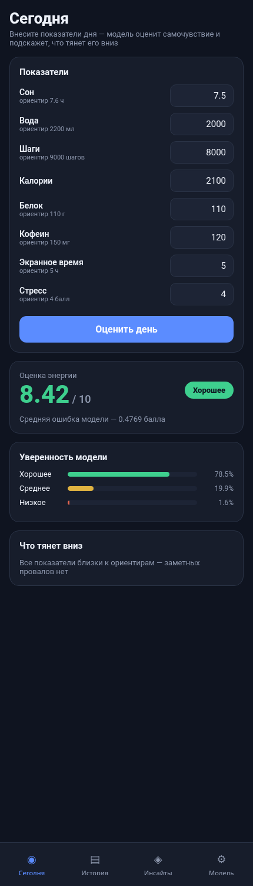
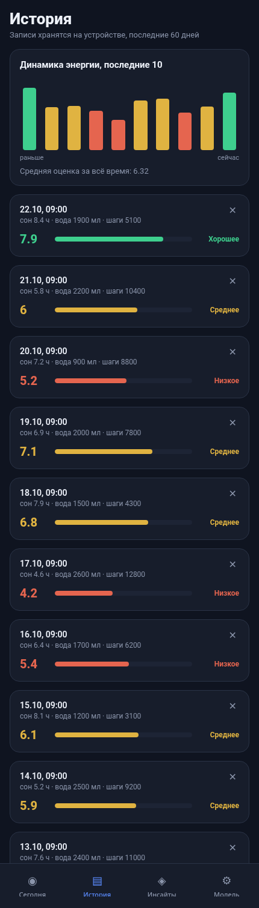
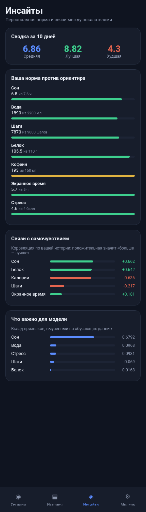

# Health Tracker — мобильное приложение с ML

Итоговый проект: мобильное приложение на React Native, которое оценивает
самочувствие по дневным показателям. Оценку даёт не формула, а обученные модели
машинного обучения на Python-бэкенде.

| Экран | | |
|---|---|---|
|  |  |  |

## Идея

Человек, следящий за здоровьем, обычно пользуется несколькими несвязанными
приложениями: одно считает воду, другое сон, третье шаги. Данные не пересекаются,
и увидеть, что именно влияет на самочувствие, невозможно.

Приложение собирает показатели дня в одном месте и отвечает на вопрос «почему
сегодня плохо»: модель оценивает день числом от 1 до 10, относит к одному из трёх
уровней и показывает, какие именно показатели просели сильнее всего.

## Архитектура

```
project/
├── backend/              Python: данные, обучение, API
│   ├── data/generate.py  генератор датасета
│   ├── model/train.py    обучение и сравнение моделей
│   └── main.py           FastAPI
└── mobile/               React Native (Expo)
    ├── App.js            навигация по вкладкам
    └── src/
        ├── lib/          api, хранилище, тема
        ├── components/   переиспользуемые элементы
        └── screens/      четыре экрана
```

Мобильное приложение не содержит ML-логики: оно отправляет показатели на бэкенд и
отображает ответ. Так модель можно переобучить, не трогая приложение.

## ML-часть

### Данные

Датасет синтетический — 900 дней, генерируется `backend/data/generate.py`.
Реальные данные пользователей не используются.

Связи заложены нелинейными, чтобы задача не решалась тривиально:

* у сна есть оптимум около 7.6 часа, отклонение в любую сторону снижает оценку;
* вода и шаги влияют через гиперболический тангенс — то есть с насыщением;
* кофеин начинает вредить только после 200 мг;
* экранное время — только после 6 часов.

Восемь признаков: сон, вода, шаги, калории, белок, кофеин, экранное время, стресс.

### Две задачи

**Регрессия** — непрерывная оценка энергии от 1 до 10.
**Классификация** — уровень самочувствия: `low`, `medium`, `high`.

Классы нарезаны по квантилям оценки, поэтому сбалансированы.

### Результаты

| Регрессия | MAE | RMSE | R² |
|---|---|---|---|
| Linear Regression | 0.774 | 1.053 | 0.473 |
| **Random Forest** | **0.485** | **0.611** | **0.823** |

| Классификация | Accuracy | F1-macro |
|---|---|---|
| Logistic Regression | 0.644 | 0.640 |
| **Random Forest** | **0.678** | **0.682** |

Линейная модель проигрывает закономерно: у сна параболическая зависимость, а
прямая её описать не может.

Классификация даёт 68 процентов, и хуже всего распознаётся средний класс
(F1 0.567 против 0.779 у низкого). Это не дефект: границы классов — квантили
непрерывной величины, и день, попавший вплотную к границе, объективно
неоднозначен. Завышать эту метрику было бы самообманом.

### Важность признаков

| Признак | Вклад |
|---|---|
| Сон | 0.698 |
| Вода | 0.095 |
| Стресс | 0.093 |
| Шаги | 0.066 |
| Остальные | менее 0.02 каждый |

Порядок совпадает с заложенным в генератор — это проверка, что модель выучила
закономерность, а не шум.

## Экраны

**Сегодня** — ввод показателей, оценка, уверенность модели по трём классам и
разбор, что тянет день вниз. Советы ранжируются по произведению важности признака
на величину отклонения от ориентира, поэтому первым идёт то, что действительно
весит больше.

**История** — записи хранятся на устройстве через AsyncStorage, столбчатый график
за последние 14 дней, удаление записи и очистка.

**Инсайты** — доступны от трёх записей. Персональная норма против ориентиров,
корреляции показателей с оценкой по собственной истории (от пяти записей) и
важность признаков по данным обучения.

**Модель** — метрики обеих задач, сравнение алгоритмов и состояние сервера.

## Запуск

### Бэкенд

```
cd backend
pip install fastapi uvicorn scikit-learn pandas numpy
python data/generate.py
python model/train.py
uvicorn main:app --reload --port 8000
```

### Приложение

```
cd mobile
npm install
npx expo start
```

Для Android-эмулятора адрес бэкенда подставляется автоматически (`10.0.2.2`),
для веба и iOS — `127.0.0.1`. Логика в `src/lib/api.js`.

Веб-версия: `npx expo start --web`.

## API

| Метод | Путь | Назначение |
|---|---|---|
| GET | `/health` | Состояние сервера и имена моделей |
| GET | `/features` | Признаки, единицы, диапазоны и ориентиры |
| GET | `/metrics` | Метрики, сравнение моделей, важность признаков |
| POST | `/predict` | Оценка дня, класс, вероятности, разбор проблем |
| POST | `/insights` | Сводка, персональная норма и корреляции по истории |

```
curl -X POST http://127.0.0.1:8000/predict -H "Content-Type: application/json" \
  -d '{"sleep_hours":4.5,"water_ml":700,"steps":1500,"calories":2600,
       "protein_g":45,"caffeine_mg":450,"screen_hours":11,"stress_level":9}'
```

```json
{
  "energy_score": 2.69,
  "wellbeing_class": "low",
  "probabilities": {"low": 0.8819, "medium": 0.1047, "high": 0.0133},
  "advice": [{"title": "Сон", "message": "Сон ниже ориентира: 4.5 против 7.6"}]
}
```

## Проверка ввода

Поля проверяются дважды. В приложении значение вне диапазона подсвечивается
красным и запрос не уходит. На сервере те же границы заданы в схеме Pydantic —
фронтенд можно обойти, поэтому бэкенд ему не доверяет.

## Ограничения

Данные синтетические, поэтому метрики показывают, что модель выучила заложенные
связи, а не что она применима к реальному здоровью. На настоящих данных качество
было бы ниже: у людей сильные индивидуальные различия, а показателей, влияющих на
самочувствие, намного больше восьми.

Корреляции на экране инсайтов считаются по десятку записей. На такой выборке
значение легко получается случайным — это видно по тому, что шаги могут выйти со
слабой отрицательной связью, хотя в данных обучения их вклад положительный.
Приложение показывает эти числа как наблюдение, а не как вывод.

Приложение не ставит диагнозов и не даёт медицинских рекомендаций.
